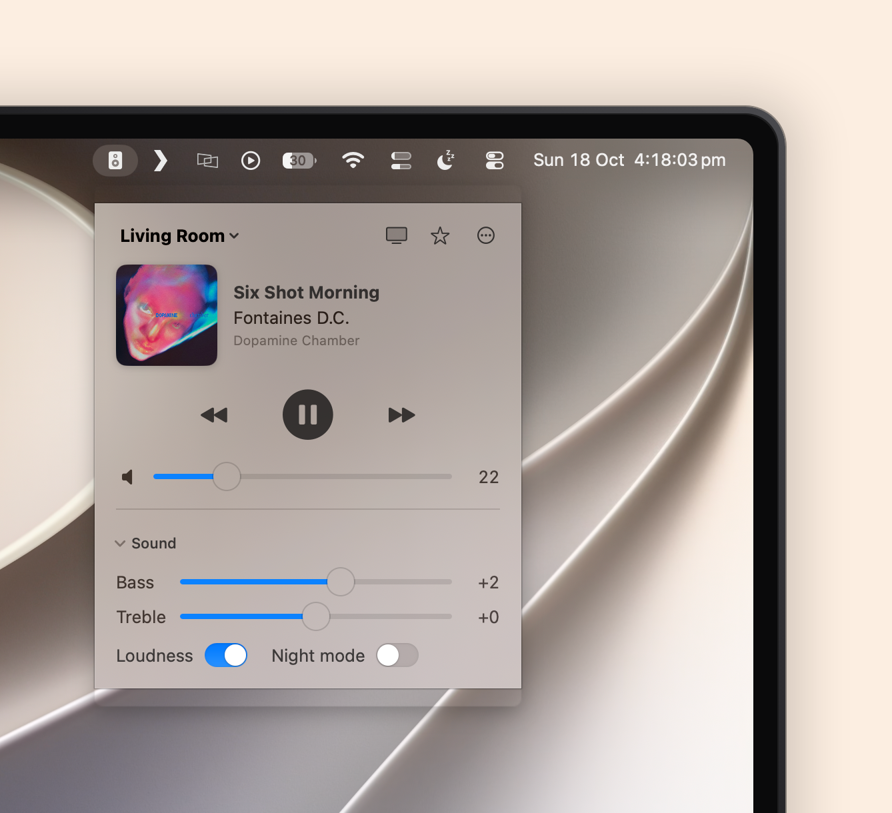

# SonosBar

A tiny macOS menu bar controller for Sonos speakers on your local network. Pick a room, play/pause, skip, set volume, and tweak bass, treble, loudness and night mode.



## Build

Requires macOS 14+ and Swift 5.9+.

```sh
./build.sh
open SonosBar.app
```

Allow local network access when prompted so it can find your speakers.
